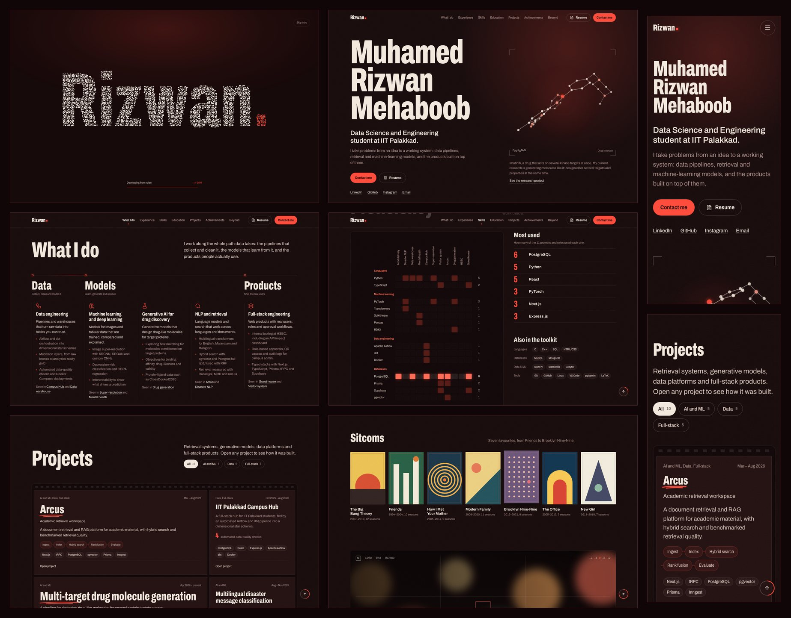

# Muhamed Rizwan Mehaboob — Portfolio

The personal portfolio of **Muhamed Rizwan Mehaboob**, B.Tech. in Data Science and Engineering at IIT Palakkad.



It follows the structure and flow of [DeveloperFolio](https://github.com/saadpasta/developerFolio) — one content config, a greeting, *What I do*, experience, proficiency, education, projects, achievements and contact — rebuilt from scratch in React + TypeScript with its own visual identity.

**The concept: a darkroom.** The site is lit like a photographic darkroom — oxblood walls, one red safelight, ivory prints — tying together photography, film and media work, and the generative models in Rizwan's research:

- **Intro:** particles start as Gaussian noise and flow along straight paths into the name — the picture behind flow matching, and a print developing in the tray. Click, tap or press any key to skip.
- **Hero:** the name at poster scale beside a live, draggable 3D model of imatinib (a multi-target drug), linking to the drug-generation research.
- **Proficiency** is a darkroom *test strip*: every lit frame is a project or role that used that technology, computed from the content, never self-rated.
- **Projects** sit on a *contact sheet*; featured frames get a grease-pencil mark, filters dim non-matching frames, and opening one prints an ivory *enlargement* with the full story.
- **Beyond academics** sits under the safelight: hover any picture, or flip the light switch, to see it in daylight colour.

---

## Quick start

Requires **Node.js 20.19+ or 22.12+** (an `.nvmrc` pins 22).

```bash
npm install        # install dependencies
npm run dev        # start the dev server at http://localhost:5173
```

```bash
npm run build      # type-check and build for production into dist/
npm run preview    # serve the production build locally at http://localhost:4173
npm run typecheck  # TypeScript only
npm run lint       # oxlint
```

No environment variables are required (see [Environment variables](#environment-variables) for two optional ones).

---

## Tech stack

| Area | Choice |
| --- | --- |
| Framework | React 19 + TypeScript |
| Build tool | Vite 8 |
| Styling | CSS Modules + design tokens in plain CSS (no CSS framework) |
| Type | Archivo variable font (width + weight axes), self-hosted via `@fontsource-variable/archivo` |
| Icons | `lucide-react` (generic icons only — no brand logos) |
| Animation | CSS transitions, `IntersectionObserver`, and two small `<canvas>` renderers (intro and molecule) — no animation library |
| Linting | oxlint |

Runtime dependencies are just React, the font and the icon set.

---

## Project structure

```
├── public/                    Static files, copied as-is into the build
│   ├── resume/                Your resume PDF (linked from the hero, nav and contact)
│   ├── images/interests/      Optional photos for teams and sitcoms
│   ├── images/photography/    Optional photos for the photography viewfinder
│   ├── favicon.svg            Browser tab icon
│   ├── apple-touch-icon.png   Home-screen icon
│   ├── og-image.jpg           Link-preview card (1200×630)
│   └── robots.txt
├── src/
│   ├── content/               ★ ALL portfolio text and data lives here
│   ├── sections/              One folder per page section (Hero, Projects, Beyond…)
│   ├── components/
│   │   ├── layout/            Navbar, mobile menu, Section wrapper, back-to-top
│   │   ├── ui/                Button, TextLink, TagList, CountUp, Develop (reveal), DarkroomImage
│   │   ├── intro/             The intro animation (canvas)
│   │   └── figures/           Molecule figure, built-in artwork, grease-pencil marks
│   ├── hooks/                 useInView, useActiveSection, useScrollMetrics, …
│   ├── lib/                   Small helpers (dates, asset paths, proficiency matrix, molecule data)
│   ├── styles/                tokens.css (colours, type scale, spacing) and global.css
│   ├── App.tsx                Page composition and the section registry
│   └── main.tsx               Entry point
├── scripts/generate-molecule.py   Regenerates the hero molecule (optional, needs RDKit)
├── docs/preview.jpg           Screenshot used at the top of this README
├── .github/workflows/deploy-pages.yml   GitHub Pages deployment
├── index.html                 HTML shell (title/description are filled in from content/site.ts)
└── vite.config.ts             Base path + metadata injection
```

The split mirrors DeveloperFolio's `containers/` and `components/`: **sections** are page-level blocks, **components** are reusable pieces, and **content** replaces `portfolio.js`.

---

## Editing content

Everything you'd want to change is in **`src/content/`**. Components only render what's there, and TypeScript checks the shapes, so a typo shows up as an error instead of a broken page.

| What | File |
| --- | --- |
| Name, intro paragraph, email, resume path, hero figure caption | `src/content/profile.ts` |
| **Social links** (LinkedIn, GitHub, Instagram, Email) | `src/content/profile.ts` → `socials` |
| Page title and description, intro animation, **section order / visibility / titles / ledes / nav labels** | `src/content/site.ts` |
| What I do | `src/content/whatIDo.ts` |
| Work experience | `src/content/experience.ts` |
| Projects (and their GitHub / live links) | `src/content/projects.ts` |
| Technologies used by projects, plus the "Also in the toolkit" list | `src/content/tech.ts` |
| Education | `src/content/education.ts` |
| Achievements | `src/content/achievements.ts` |
| Certifications | `src/content/certifications.ts` |
| Beyond academics: languages, tools, teams, sitcoms, photography, extracurriculars | `src/content/beyond.ts` |

### Social links

Edit `socials` in `src/content/profile.ts`. Each entry has a label, the handle shown in the contact section, and the URL. The order there is the order on the page. The email address is also set once in `profile.email`.

### Sections: show, hide, rename, reorder

In `src/content/site.ts`, each section has:

- `display` — `true` / `false` (like DeveloperFolio), or `'auto'` to show only when it has content.
- `title` and `lede` — the heading and the sentence next to it.
- `nav` — the label in the top navigation; remove it to keep a section out of the nav.

The order of keys in `sections` is the order on the page.

### Projects

Add or edit entries in `src/content/projects.ts`:

- `featured: true` gives a wider frame, shows the pipeline on the card, and adds the grease-pencil mark.
- `domains` (`'ai' | 'data' | 'web'`) drive the filters.
- `pipeline` is the step-by-step flow shown on the card/enlargement; `metric` is an optional headline number.
- `stack` lists technologies **by their name in `tech.ts`** (TypeScript will tell you if a name is missing).
- `links` — none of the uploaded files listed repository URLs, so every project starts with `links: []`. Add them like this and a link row appears automatically:

  ```ts
  links: [
    { label: 'GitHub', href: 'https://github.com/Rizzwan285/<repo>' },
    { label: 'Live demo', href: 'https://…' },
  ],
  ```

### Proficiency

The matrix is **computed**: rows are technologies marked `matrix: true` in `src/content/tech.ts`; columns are every project plus any role with `inMatrix: true` in `experience.ts`, ordered oldest to newest. Add a project and its technologies light up on their own. To add a technology, register it in `tech.ts` first (with a category), then use it in a `stack`.

### Certifications

Your resume doesn't list any certifications, so none were invented: `certifications.ts` starts empty and the section stays hidden (`display: 'auto'`). Add an entry and the section appears — the file includes a template.

---

## Images

### Teams and sitcoms

Team badges, crests and show posters are trademarked/copyrighted artwork, so the site doesn't ship them. Each card has **original built-in artwork** (a pitch, a court, abstract posters) and an **optional image slot**:

1. Put your image in `public/images/interests/`, e.g. `real-madrid.jpg`.
2. In `src/content/beyond.ts`, add `image` (and optionally `imageAlt`) to that team or show:

   ```ts
   { id: 'real-madrid', …, image: 'images/interests/real-madrid.jpg', imageAlt: 'What the photo shows' },
   ```

Any image you add gets the same safelight treatment (red duotone until hovered or the lights are switched on), so a mixed set of photos still looks like one series. Use images you have the rights to — your own photos are ideal.

Recommended sizes: tickets **16:10**, at least 800×500. Posters **2:3**, at least 600×900. JPG or WebP, under ~250 KB each.

### Photography

The **View my photography** button links to your Google Photos album (`beyond.photography.albumUrl`). To also show photos on the site:

1. Export a few favourites into `public/images/photography/` (3:2, ~1600 px wide, JPG/WebP).
2. List them in `beyond.photography.photos`:

   ```ts
   photos: [
     { src: 'images/photography/my-photo.jpg', alt: 'What the photo shows', caption: 'Optional caption' },
   ],
   ```

They play inside the viewfinder and appear as a contact sheet below it.

### Resume

Replace `public/resume/Muhamed_Rizwan_Mehaboob_Resume.pdf`. If you rename the file, update `profile.resume` in `src/content/profile.ts`.

### Favicon and link preview

`public/favicon.svg`, `public/apple-touch-icon.png` (180×180) and `public/og-image.jpg` (1200×630) can be replaced with files of the same names.

### Hero molecule

The molecule data lives in `src/lib/molecule.data.ts`, generated by `scripts/generate-molecule.py` (Python + RDKit). Change `SMILES` and `NAME` in the script and run it to show a different molecule; if the new molecule has elements beyond C, N and O, add a colour for each to `ATOM_STYLE` in `src/components/figures/MoleculeFigure.tsx`.

---

## Intro animation

Configured in `src/content/site.ts` → `intro`:

| Option | Default | Effect |
| --- | --- | --- |
| `enabled` | `true` | Turn the intro off entirely |
| `oncePerSession` | `false` | `true` plays it only on the first load in a browser tab |
| `word` | `'Rizwan'` | The word the particles assemble into |
| `durationMs` | `1700` | How long the particles take to settle |

It is skipped automatically for visitors who prefer reduced motion, and any click, tap or key press skips it. The page loads underneath while it plays.

---

## Design system

All colours, type sizes, spacing, radii and easing curves are CSS custom properties in **`src/styles/tokens.css`**.

| Token | Value | Role |
| --- | --- | --- |
| `--darkroom` | `#170a0b` | Page background (oxblood black) |
| `--velvet` | `#221011` | Raised surfaces |
| `--safelight` | `#ff4a3a` | The only light source: focus, marks, glows, primary buttons |
| `--print` | `#f3e8dd` | Ivory "paper": headings and the project enlargement |
| `--print-dim` / `--fixer` | `#d9c6bc` / `#a88c86` | Body and secondary text |

Typography is a single family, **Archivo**, using its width axis: `--display-stretch: 64%` for poster-scale headings, normal width for reading text, and `--label-stretch: 88%` for small labels.

---

## Environment variables

None are required. Two optional ones (copy `.env.example` to `.env`):

| Variable | Purpose |
| --- | --- |
| `VITE_SITE_URL` | Public URL of the deployed site (e.g. `https://rizwan.dev`). When set, the build adds a canonical link and absolute Open Graph image tags, so shared links show the preview card. |
| `VITE_BASE` | Sub-path the site is served from. Leave unset for a domain root. Needed only for GitHub Pages *project* sites (`/<repo>/`); the included workflow sets it automatically. |

---

## Deploying

The production build in `dist/` is a static site: it can go on any static host.

### Vercel

1. Push the project to a GitHub repository.
2. On vercel.com → **Add New… → Project** → import the repository. Vercel detects Vite (build `npm run build`, output `dist`).
3. Optional: add `VITE_SITE_URL` under **Settings → Environment Variables**, then redeploy.

### Netlify

1. Push to GitHub, then **Add new site → Import an existing project**.
2. Build command `npm run build`, publish directory `dist`.
3. Optional: add `VITE_SITE_URL` under **Site configuration → Environment variables**.

### GitHub Pages

1. Push to a GitHub repository with a `main` branch.
2. **Settings → Pages → Build and deployment → Source: GitHub Actions.**
3. Every push to `main` runs `.github/workflows/deploy-pages.yml`, which builds with the right base path (`/` for a `<user>.github.io` repo, `/<repo>/` otherwise) and publishes.
4. Optional: add a repository **variable** `VITE_SITE_URL` (Settings → Secrets and variables → Actions → Variables) with the site's URL.

### Anywhere else

Run `npm run build` and upload the contents of `dist/`. If the site will live under a sub-path, build with `VITE_BASE=/that-path/ npm run build`.

---

## Accessibility and performance

- Semantic landmarks and headings, a skip link, visible keyboard focus, labelled controls; native `<dialog>` for the project enlargements and the mobile menu (focus is trapped and restored, Esc closes).
- `prefers-reduced-motion` turns off the intro, auto-rotation and animated reveals.
- Audited with axe-core at desktop and mobile widths: no violations.
- The canvases pause when off-screen or when the tab is hidden; the intro allocates its buffers once.
- The font is self-hosted and split by script, so browsers download only the Latin file (~90 KB).

---

## Credits

Structure and navigation flow inspired by [DeveloperFolio](https://github.com/saadpasta/developerFolio) by Saad Pasta. No code from it is used here; this project is an independent implementation. Molecular geometry generated with [RDKit](https://www.rdkit.org/).
